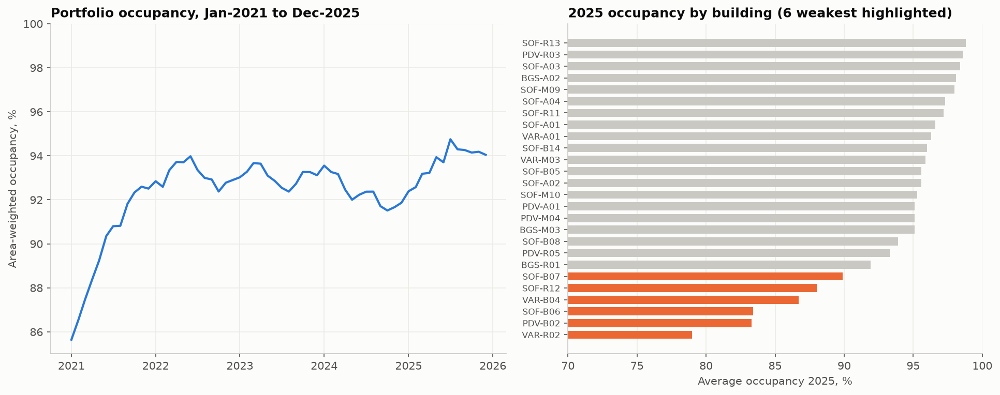
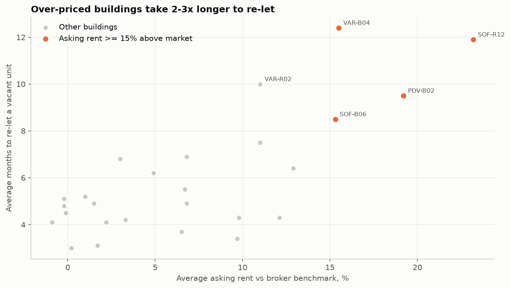
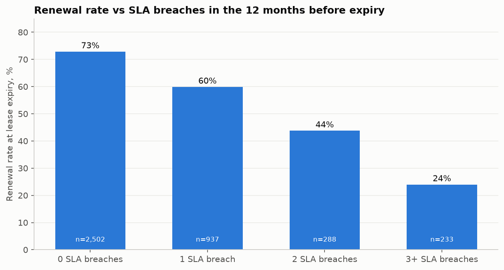
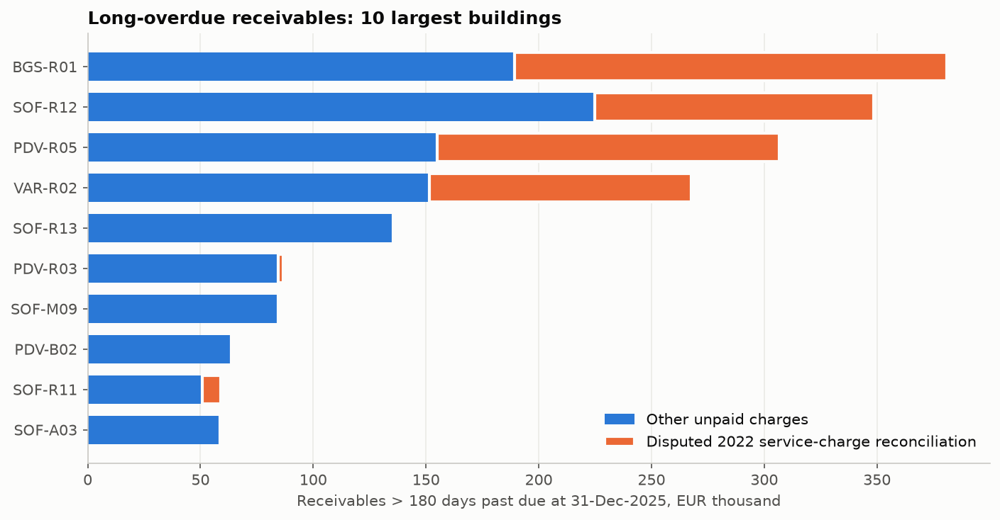
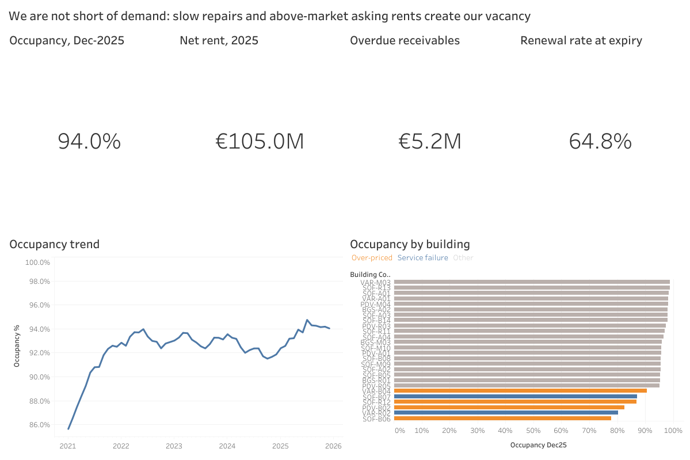

# Commercial Property Leasing Performance & Tenant Analytics

**Client:** commercial real-estate owner / property manager, Bulgaria
**Portfolio:** 26 office, retail and mixed-use buildings in Sofia, Plovdiv, Varna and Burgas · 3,113 units · 615,000 sqm GLA
**Period analysed:** Jan-2021 – Dec-2025 · **Role:** freelance BI analyst
**Stack:** PostgreSQL · SQL (CTEs, window functions, gaps-and-islands, ROLLUP) · Python (pandas, matplotlib) · Tableau
**Live dashboard:** [Tableau Public](https://public.tableau.com/views/CommercialPropertyLeasingAnalytics-Bulgaria/ExecutiveOverview)

> Tenant and building identities are replaced by codes under the client NDA. The data in this repository is an anonymised rebuild with the same structure, volumes (819,587 raw rows, incl. 588,116 invoice lines) and data-quality issues as the original extracts.

---

## The problem
Leadership saw ~94% occupancy and a 99% collection rate, yet income growth was lagging the market. The existing reports answered *"how much is let?"*. Nobody had connected occupancy to **re-letting time, renewal behaviour, maintenance quality and cash collection**, so the team was spending its effort on marketing vacant units instead of on the reasons units became vacant.

## What I did
1. **Built the pipeline** from seven ERP/CAFM extracts into PostgreSQL: `raw` (text landing) → `clean` (typed, standardised, de-duplicated, every rule logged in `clean.dq_log`) → `mart` (star schema with a unit × month occupancy grain).
2. **Asked "why" at each step** instead of reporting averages: which buildings, which units, which tenants, and what they have in common.
3. **Delivered** an analysis notebook, three Tableau dashboards, a one-page executive summary and a 2026 retention watch-list the leasing team now works from.

## Key findings

**1. Vacancy is concentrated, not portfolio-wide.** Six grade-B buildings hold **52% of vacant space** but only 23% of GLA. Inside them sit two different problems.



**2. Over-pricing keeps space empty.** Four buildings ask 15–23% above the broker market benchmark and need **8.5–12.4 months to re-let**, against 4.7 months for fairly priced buildings. Units priced more than 25% above market are **2.3x as likely** to stay empty for a year or more, and those buildings give away *more* rent-free to defend the headline rent.



**3. Slow repairs drive tenants out.** Renewal falls from **73%** for tenants with no maintenance SLA breaches in their last 12 months to **24%** for tenants with three or more. Two buildings (one built in 1998) breach SLA on two thirds of tickets, mostly HVAC, and have the lowest renewal rates in the portfolio (35% and 37%).



**4. Cash is stuck in a dispute, not in bad debt.** 53% of receivables older than 180 days sit in four retail centres, driven by the **2022 service-charge reconciliation** billed after the energy-price shock. Office tenants paid it; 27% of the retail amount is still open, while the same tenants pay monthly rent on time.



## Impact

| Driver | Estimated cost |
|---|---|
| Tenants lost to service failures (2 buildings) | ~EUR 0.67M rent per year |
| Over-priced space standing empty (4 buildings) | ~EUR 0.70M rent per year |
| Disputed service-charge reconciliation | EUR 0.62M cash tied up |

Together about **1.3% of annual net rent (EUR 105M)**, none of it visible in the headline occupancy. Estimates are conservative (empty months only, no fit-out or agent fees).

## Recommendations
1. Send the **2026 retention watch-list** to leasing now: 51 high-risk leases, EUR 1.6M rent p.a.
2. **HVAC remediation and SLA recovery** in the two failing buildings before spending on marketing there.
3. **Re-price vacant units** in the four over-priced buildings to within 5% of benchmark; trade headline rent for term rather than rent-free.
4. **Settle the reconciliation dispute** with instalment plans linked to lease extensions.
5. Track **SLA breach rate** as a standing KPI: it predicts non-renewal 6–12 months ahead.

---

## Repository structure
```
├── data/
│   ├── raw/                     # source extracts (CSV, with original data-quality issues)
│   └── reference/               # broker market-rent benchmark Q4-2025
├── sql/
│   ├── 01_raw_schema.sql        # landing tables (all TEXT)
│   ├── 02_load_raw.sql          # \copy loads
│   ├── 03_clean.sql             # typing, standardisation, de-duplication, dq_log
│   ├── 04_mart.sql              # star schema + unit x month grain + SLA + expiry facts
│   ├── 05_tableau_views.sql     # flat views for Tableau
│   └── analysis/                # a01–a10: one business question per file
├── src/
│   ├── generate_data.py         # rebuilds the anonymised extracts
│   ├── run_pipeline.py          # builds the whole database (no psql needed)
│   ├── db.py                    # connection + query helper (reads .env)
│   └── export_tableau.py        # writes tableau/data/*.csv
├── notebooks/property_leasing_analysis.ipynb
├── tableau/                     # extracts + dashboard build guide
├── reports/
│   ├── executive_summary.md
│   └── figures/
└── .env.example                 # connection settings template
```

## Data model
| Table | Grain | Rows |
|---|---|---|
| `mart.fact_invoice_line` | invoice line | 586,357 |
| `mart.fact_unit_month` | unit × month | 186,780 |
| `mart.fact_payment` | cash receipt | 183,280 |
| `mart.fact_invoice` / `fact_receivable` | lease × month invoice | 172,280 |
| `mart.fact_ticket` | maintenance ticket + SLA | 32,736 |
| `mart.fact_lease` | lease contract | 7,111 |
| `mart.fact_lease_expiry` | expiry + 12-month service history | 3,960 |
| `mart.dim_building` / `dim_unit` / `dim_tenant` / `dim_month` | | 26 / 3,113 / 4,449 / 60 |

### Data-quality issues handled (from `clean.dq_log`)
699 lease rents recorded in BGN (converted at the 1.95583 peg) · 3,593 leases with DD.MM.YYYY or DD/MM/YYYY dates · 1,759 duplicate invoice lines · 733 duplicate receipts · 11,713 amounts with comma decimals · HVAC logged under three names · 41 tickets closed before they were opened · zero and negative unit areas.

## How to run
Requires PostgreSQL 14+ and Python 3.10+. Works the same on Windows, macOS and Linux.
```bash
pip install -r requirements.txt
cp .env.example .env                 # Windows: copy .env.example .env  -> then put your PostgreSQL password in .env
python src/run_pipeline.py           # creates the database, runs sql/01-05, exports Tableau CSVs (~20 s)
jupyter notebook notebooks/property_leasing_analysis.ipynb
```
`python src/generate_data.py` rebuilds `data/raw` from scratch (optional; the files are already included).

## Dashboards
**Live dashboard (Tableau Public):** [Executive overview](https://public.tableau.com/views/CommercialPropertyLeasingAnalytics-Bulgaria/ExecutiveOverview)



Build guide: [`tableau/README.md`](tableau/README.md)
